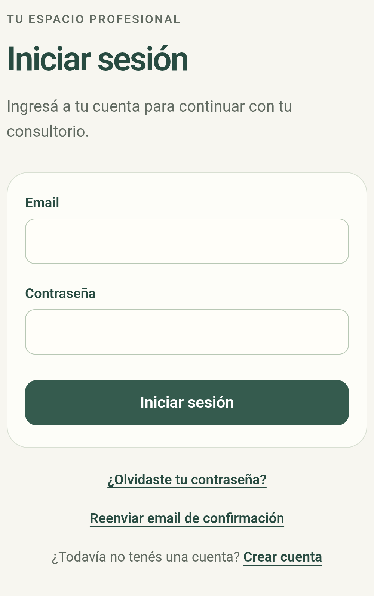
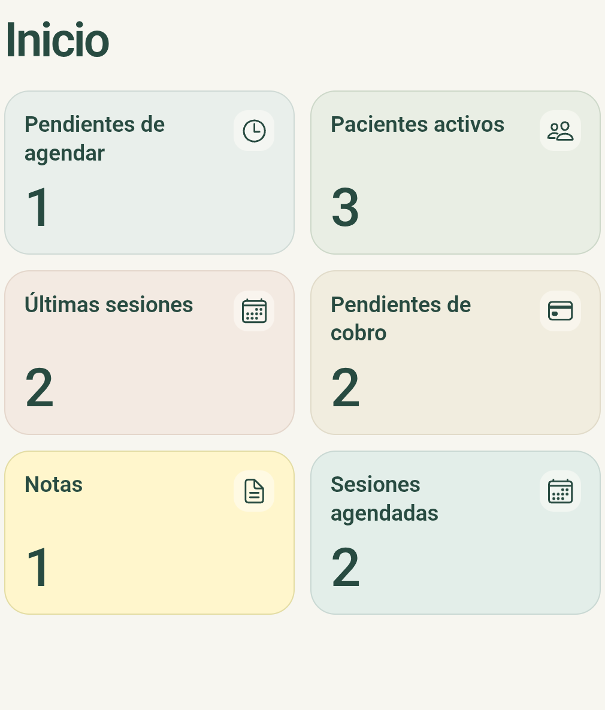
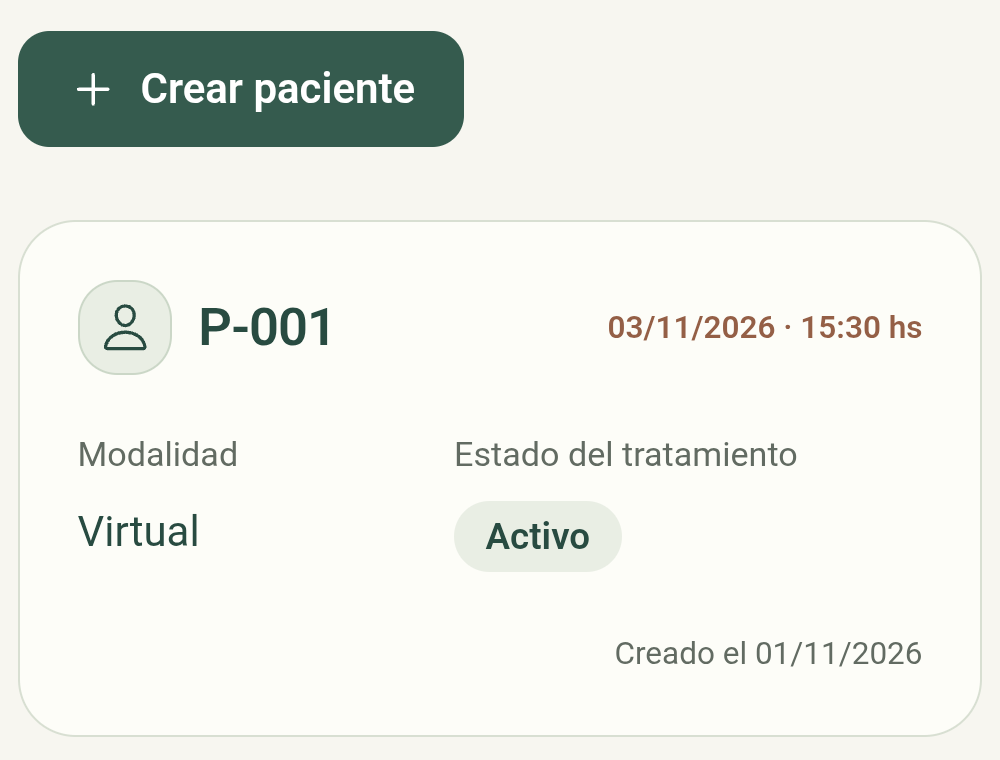
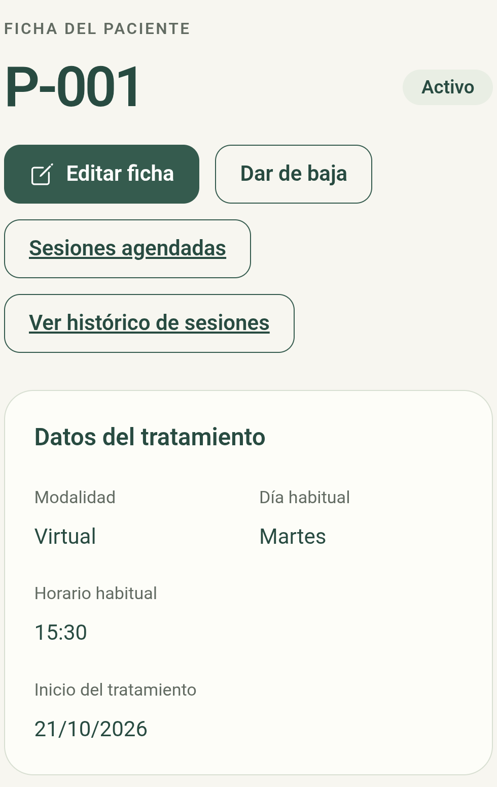
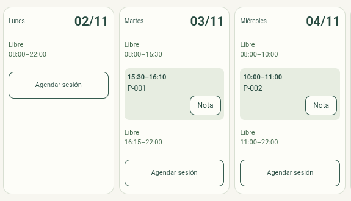
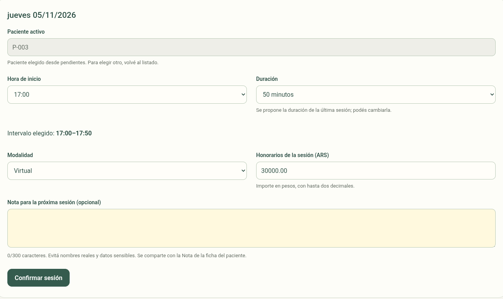
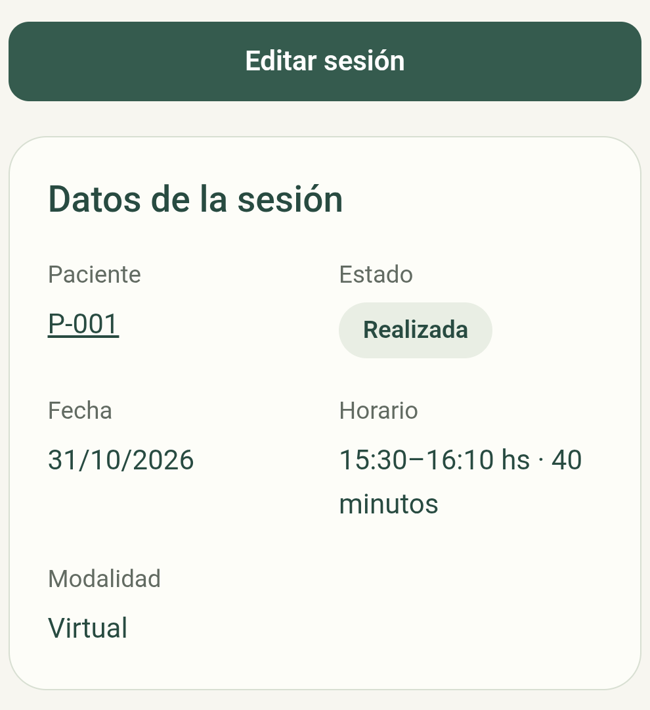
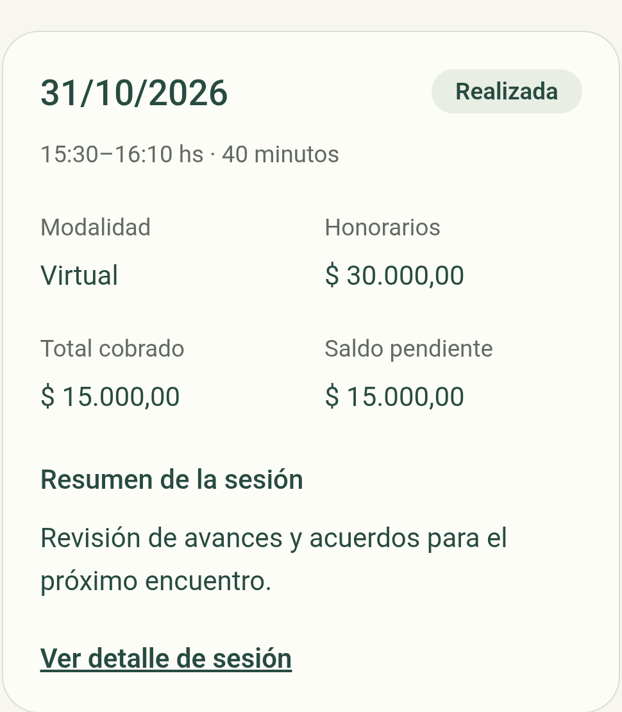
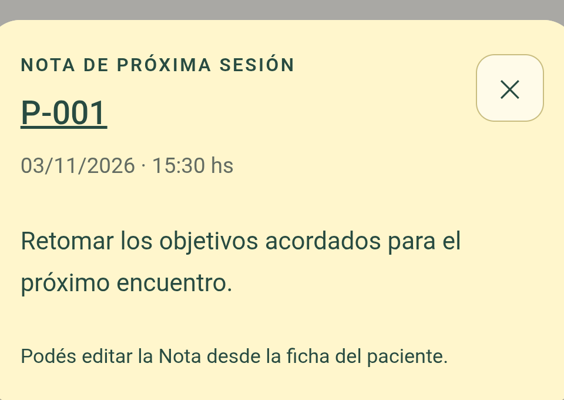
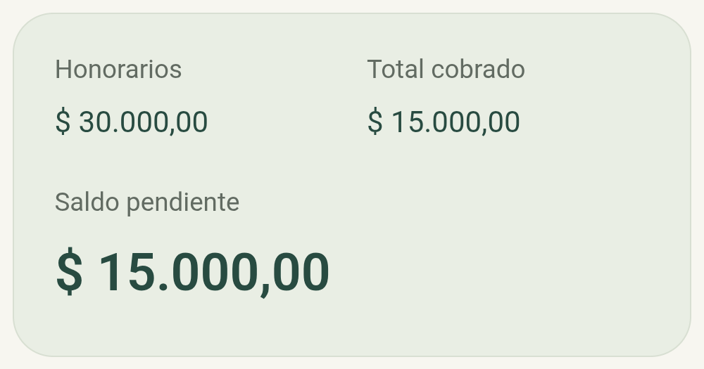

# 1. Introducción, problema y objetivos

PSIQUE es una aplicación de seguimiento psicoterapéutico y administración de consultorio dirigida a profesionales de la psicología. Reúne pacientes identificados mediante códigos, agenda, sesiones, notas breves, honorarios y cobros en un espacio privado por profesional.

Este documento describe la versión comprobada al 1 de noviembre de 2026. Su finalidad es que una persona nueva comprenda qué hace el sistema, cómo se utiliza y qué límites tiene. Complementa la documentación técnica y la presentación de esta entrega.

## Necesidad identificada

La gestión cotidiana requiere relacionar información que puede quedar dispersa: quién tiene una próxima sesión, qué tema conviene retomar, qué encuentros se realizaron y cuánto falta cobrar. Esa dispersión dificulta la consulta y puede producir olvidos o inconsistencias entre agenda y registros económicos.

## Objetivo general

Centralizar la organización del consultorio y el seguimiento básico de las sesiones, conservando la separación de información entre profesionales.

## Objetivos específicos

- Identificar pacientes mediante códigos o alias, sin exigir sus nombres reales.
- Consultar la agenda y reservar intervalos sin superposiciones.
- Confirmar manualmente la realización de cada encuentro.
- Conservar un resumen breve por sesión y una Nota vigente para el próximo encuentro.
- Registrar honorarios, total cobrado y saldo de cada sesión.
- Mostrar accesos e indicadores calculados desde los registros del profesional.
- Ofrecer la misma interfaz en navegador y en una aplicación Android instalable.

La aplicación asiste la organización profesional. No formula diagnósticos ni toma decisiones terapéuticas automáticas.

<!-- PAGE -->
# 2. Usuarios destinatarios y alcance

El usuario principal es el profesional psicólogo que administra su propia práctica. Cada cuenta dispone de sus pacientes y sesiones. Los pacientes no ingresan al sistema ni realizan reservas por sí mismos. Tampoco existe una pantalla de administración general de profesionales.

| Módulo implementado | Qué permite hacer |
| --- | --- |
| Cuenta profesional | Registrarse, confirmar email, ingresar, recuperar contraseña y cerrar sesión. |
| Inicio | Consultar seis accesos con contadores de actividad y pendientes. |
| Pacientes | Crear fichas, consultarlas, editarlas y dar de baja de forma lógica. |
| Agenda | Recorrer semanas y consultar sesiones y franjas libres calculadas. |
| Agendamiento | Elegir paciente activo, fecha, inicio, duración, modalidad, honorarios y Nota opcional. |
| Sesiones | Consultar, editar, reprogramar, desagendar y confirmar asistencia. |
| Seguimiento | Consultar histórico individual, resumen de sesión y Nota de próximo encuentro. |
| Honorarios y cobros | Registrar importes acumulados por sesión y consultar saldos pendientes. |
| Android | Ejecutar el frontend empaquetado como APK de depuración mediante Capacitor. |

## Condiciones de uso actuales

La ejecución integrada es local: Express y PostgreSQL funcionan en la computadora. El navegador accede a esa API y el APK de prueba lo hace mediante un túnel USB/ADB. La instalación Android no incorpora el servidor ni la base clínica dentro del teléfono.

Los registros se conservan en PostgreSQL. Una pantalla vacía o un contador en cero representa ausencia de registros para esa cuenta, no datos de demostración precargados.

Todas las capturas de esta entrega contienen exclusivamente información ficticia de un entorno de pruebas aislado.

<!-- PAGE -->
# 3. Cuenta profesional y acceso

## Crear una cuenta

Desde Login, seleccionar **Crear cuenta**. Completar email, contraseña y repetición. El email debe ser válido y no estar registrado. La contraseña debe tener entre 12 y 128 caracteres y coincidir con su repetición.

La cuenta nueva requiere confirmar su email. Abrir el enlace recibido y confirmar con el botón de la pantalla. El enlace vence a las 24 horas. Si el envío falla o el enlace vence, utilizar **Reenviar email de confirmación** desde Login.

## Ingresar y salir

Ingresar email y contraseña y seleccionar **Iniciar sesión**. Las credenciales correctas de una cuenta confirmada habilitan Inicio. Una cuenta nueva no confirmada recibe un aviso y no puede entrar todavía.

La sesión dura una hora. **Cerrar sesión** vuelve a Login y retira la información local de las pantallas privadas. Una recarga de la misma sesión puede conservar el acceso; no existe renovación automática del vencimiento.

Las cuentas anteriores a la incorporación de confirmación conservaron el acceso por una excepción de compatibilidad. Esto no significa que esas direcciones se hayan verificado mediante correo.

<!-- PAGE -->
# 4. Guía de primera utilización

## Un recorrido de principio a fin

1. **Acceder.** Crear y confirmar la cuenta, o iniciar sesión con una existente.
2. **Crear el primer paciente.** Entrar en Pacientes, seleccionar Crear paciente y completar un código o alias, modalidad y los textos opcionales.
3. **Elegir la próxima fecha.** Abrir Agenda o Pendientes de agendar. Elegir un día habilitado, un inicio y una duración disponible.
4. **Confirmar la reserva.** Seleccionar el paciente activo, modalidad y honorarios. Agregar una Nota si resulta útil y confirmar la sesión.
5. **Preparar el encuentro.** Consultar Sesiones agendadas, la ficha o Notas. El calendario también permite abrir la Nota del próximo encuentro.
6. **Registrar lo ocurrido.** Cuando haya llegado el horario, abrir la sesión y marcarla como Realizada si efectivamente ocurrió. Agregar un resumen opcional.
7. **Registrar el cobro.** En Editar sesión, escribir el total acumulado recibido. El sistema calcula el saldo.
8. **Confirmar la siguiente fecha.** Una vez terminado el intervalo, el paciente activo vuelve a pendientes si no tiene otro bloque futuro o en curso.

## Navegación habitual

La barra inferior contiene **Inicio**, **Pacientes** y **Agenda**. Desde Inicio se accede también a pendientes, últimas sesiones, cobros, Notas y sesiones agendadas. Desde la ficha se abren el histórico y las reservas del paciente.

## Antes de guardar

Revisar los datos del formulario. Seleccionar una fecha o un resultado del buscador todavía no reserva el horario: la operación se confirma al guardar. Cancelar descarta el borrador. Si falla la conexión o existe un conflicto, la pantalla informa el problema y conserva lo escrito para corregirlo.

Si la API no está disponible, los listados muestran un error. No se reemplazan por registros inventados ni se confirma un guardado que no ocurrió.

<!-- PAGE -->
# 5. Inicio y sus seis accesos

Inicio presenta un mosaico de dos columnas y tres filas. Sus cantidades pertenecen exclusivamente a la cuenta abierta y se actualizan al volver a la pantalla.

| Acceso | Interpretación del contador |
| --- | --- |
| Pendientes de agendar | Pacientes activos sin sesión futura ni en curso. |
| Pacientes activos | Fichas cuyo estado es Activo. |
| Últimas sesiones | Pacientes con al menos una sesión Realizada. Se muestra una última realizada por paciente. |
| Pendientes de cobro | Sesiones Realizada con saldo positivo, de cualquier fecha. |
| Notas | Próximas sesiones programadas con Nota no vacía. |
| Sesiones agendadas | Reservas Programada futuras o en curso, incluidos los dos bloques consecutivos cuando existen. |

El listado de Notas también incluye próximas sesiones sin texto, aunque no sumen en su contador. Últimas sesiones no equivale al total de sesiones realizadas: representa una por paciente. El contador de cobros sí cuenta sesiones, no pacientes ni pesos.

<!-- PAGE -->
# 6. Alta y listado de pacientes

En **Pacientes → Crear paciente**, el sistema propone un código disponible. Se puede personalizar o dejar vacío para que se genere al guardar. La sugerencia no reserva el código.

| Dato del alta | Regla de uso |
| --- | --- |
| Código | Entre 1 y 12 caracteres. Comienza con letra sin tilde o número; luego admite letras, números, guion y guion bajo. Sin espacios. «nuevo» está reservado. |
| Modalidad | Presencial o Virtual. Puede diferir de la modalidad de una sesión concreta. |
| Motivo de consulta | Opcional, hasta 3000 caracteres. |
| Nota de próxima sesión | Opcional, hasta 300 caracteres. Conviene evitar datos sensibles. |

El alta siempre crea un paciente **Activo**. No solicita estado, frecuencia ni una fecha de inicio del tratamiento. La fecha de creación la asigna el sistema y no se edita.

Una ficha puede guardarse sin reserva y aparecer en Pendientes de agendar. El propio alta también permite elegir la primera reserva y confirmar **Crear paciente y agendar**. Si falla esa operación conjunta, no queda un alta parcial.

Los códigos son únicos dentro de una cuenta sin distinguir mayúsculas. Dos profesionales distintos pueden utilizar P-001. Se recomienda evitar nombres reales: el código aparece en listados, agenda y direcciones de navegación.

<!-- PAGE -->
# 7. Ficha, edición y estado del tratamiento

La ficha presenta modalidad, día y horario habitual informativos, inicio del tratamiento, motivo y Nota. **Editar ficha** permite cambiar código, modalidad, estado y textos. Guardar confirma; Cancelar conserva los valores anteriores.

**Inicio del tratamiento** es la fecha más antigua de las sesiones marcadas como Realizada. Antes de la primera aparece **Sin sesiones realizadas**. La aplicación lo recalcula al corregir sesiones; el profesional no escribe esa fecha.

| Estado o acción | Efecto |
| --- | --- |
| Activo | Permite reservar y puede integrar pendientes de agendar. |
| Suspendido / De vacaciones | Se muestra en Pacientes no activos y no admite nuevas reservas. Conserva las reservas ya existentes. |
| Dar de baja | Tras confirmación, marca De baja y cancela sesiones Programada que aún no comenzaron. Conserva ficha, histórico e importes. |

Los pacientes no activos se consultan en una pantalla separada. Desde su ficha pueden reactivarse cambiando el estado. Editar la ficha no mueve automáticamente una sesión; para reprogramar se abre el detalle de esa sesión.

<!-- PAGE -->
# 8. Agenda semanal y disponibilidad

Agenda comienza en la semana actual, de lunes a domingo. **Anterior**, **Esta semana** y **Siguiente** permiten recorrerla. Se pueden consultar semanas pasadas, aunque sus fechas ya no admitan nuevas reservas.

## Cómo interpretar los espacios libres

La aplicación calcula disponibilidad entre **08:00 y 22:00, de lunes a sábado**, restando las sesiones no canceladas. Muestra los intervalos anteriores a la primera sesión, los intermedios y los posteriores. Solo ofrece una reserva donde cabe un encuentro de al menos 30 minutos.

No se cargan rangos laborables ni horarios disponibles por separado. Los domingos aparecen deshabilitados. Para hoy se excluyen los inicios que ya transcurrieron. El reloj del consultorio utiliza la zona de Buenos Aires.

Las nuevas fechas pueden elegirse desde hoy hasta el último día del mes siguiente. Consultar otra semana no amplía ese plazo.

Los comienzos avanzan cada 15 minutos. Si una sesión termina a las 16:10, la próxima opción de inicio es 16:15, siempre que quepa su duración. Las franjas verdes representan sesiones existentes, no tiempo libre.

Los límites horarios son reglas elegidas para PSIQUE. No expresan un estándar clínico general.

<!-- PAGE -->
# 9. Agendar una próxima sesión

Desde Agenda o Pendientes, abrir el calendario y elegir un día habilitado. Buscar el código del paciente y confirmar un resultado. Escribir texto sin seleccionarlo no identifica una ficha válida.

Completar inicio, duración, modalidad y honorarios. Las duraciones permitidas son **30, 40, 50 o 60 minutos**. Si hay una sesión anterior, se propone su duración, que puede modificarse. La Nota es opcional y admite hasta 300 caracteres.

Al confirmar, el sistema vuelve a verificar el intervalo completo. Aumentar la duración puede provocar un conflicto con otra sesión o superar las 22:00. En ese caso se informa el error y no se desplazan reservas ajenas ni se guardan cambios parciales.

Solo se agenda a pacientes activos. Por paciente se admite **una fecha futura**, con la excepción de hasta **dos sesiones consecutivas en ese mismo día**. Cada bloque conserva sus importes y estado. No se permite un tercer bloque, dos fechas futuras distintas ni dos bloques separados.

La pantalla de reserva no crea pacientes: el alta se inicia desde Pacientes. Cuando se llega desde Pendientes de agendar, el paciente seleccionado aparece bloqueado para conservar ese contexto.

<!-- PAGE -->
# 10. Pendientes y sesiones agendadas

## Pendientes de agendar

Esta pantalla reúne pacientes activos sin sesión futura o en curso. Una ficha recién creada puede aparecer con **Primera sesión pendiente de agendar**. Para pacientes con encuentros anteriores, muestra la última sesión no cancelada como referencia.

- **Mantener el horario la próxima semana** propone el mismo día de semana e inicio para la siguiente semana. No reserva automáticamente y vuelve a comprobar disponibilidad.
- **Elegir fecha** permite seleccionar otra fecha habilitada y conservar la duración propuesta o cambiarla.
- **Dejar sin próxima fecha / marcar como no pendiente** informa que el paciente pasará a Suspendido y pide confirmarlo. Solo después del guardado desaparece de pendientes.

El paso del tiempo vuelve a incluir al paciente activo una vez finalizado el último intervalo reservado. Esto ocurre aunque aún no se haya confirmado su asistencia. Agendar y confirmar realización son decisiones diferentes.

## Sesiones agendadas

**Inicio → Sesiones agendadas** reúne reservas Programada futuras y en curso, ordenadas por fecha y horario. Desde la ficha se abre la misma pantalla filtrada por paciente.

Cada reserva muestra fecha, inicio, final, duración, modalidad, honorarios, cobrado y saldo. La próxima de cada paciente incorpora la Nota vigente. No se repite en un segundo bloque consecutivo.

Al finalizar el intervalo, una sesión Programada deja de aparecer aquí; no se transforma por ello en Realizada. Para consultar asistencia efectiva se utiliza el histórico.

<!-- PAGE -->
# 11. Registro, edición y cancelación de sesiones

Toda reserva nueva comienza **Programada**. Desde su detalle se puede seleccionar **Marcar como realizada** cuando llegó su horario de inicio. El profesional confirma así que el encuentro ocurrió; no debe utilizar el paso del tiempo como confirmación de asistencia.

## Editar o reprogramar

**Editar sesión** abre un borrador con fecha, inicio, duración, modalidad, estado, honorarios, total cobrado y resumen opcional. Para elegir otro intervalo futuro se ofrece el calendario. Guardar confirma el conjunto; Cancelar descarta el borrador.

Cuando el horario original ya pasó, el paciente queda bloqueado, incluso si se corrige la fecha en esa misma edición. Se conserva así la asignación histórica. El servidor también rechaza una reasignación de ese tipo.

## Desagendar

Solo una sesión Programada que todavía no comenzó puede desagendarse. Tras la confirmación, queda **Cancelada**, conserva sus datos e importes y libera su intervalo. No se reserva automáticamente la semana siguiente. Una sesión Cancelada no se reactiva: corresponde crear otra reserva.

<!-- PAGE -->
# 12. Últimas sesiones e histórico individual

**Inicio → Últimas sesiones** muestra una única sesión Realizada por paciente: la más reciente según fecha y horario. Incluye pacientes no activos si tienen asistencia registrada. No tiene un recorte de dos meses ni navegación semanal.

Para consultar todos los encuentros de una persona, abrir **Ficha → Ver histórico de sesiones**. Solo aparecen sesiones marcadas como Realizada, de más reciente a más antigua. Una reserva con fecha pasada pero sin asistencia confirmada no integra ese listado.

Ambos listados se presentan en páginas de **cinco sesiones**. Anterior y Siguiente aparecen cuando corresponde e indican la página y el total. Al regresar de un detalle se conserva la página, ajustándola si una corrección redujo la cantidad. Las cantidades de encabezados y de Inicio representan el total completo.

Las tarjetas muestran fecha, horario y duración, modalidad, resumen cuando existe, honorarios, cobrado y saldo. Seleccionarlas abre el detalle ya existente. El histórico consulta los mismos registros: no crea copias ni otra historia paralela.

<!-- PAGE -->
# 13. Nota vigente y resumen histórico

PSIQUE distingue dos textos con finalidades diferentes.

| Texto | Dónde se utiliza | Límite y conservación |
| --- | --- | --- |
| Nota de próxima sesión | Ficha, reserva, calendario y listado Notas. | Hasta 300 caracteres. Es un único texto vigente por paciente, sin versiones por sesión. |
| Resumen de la sesión | Edición, detalle e histórico de una sesión. | Hasta 100 caracteres. Queda guardado en ese encuentro concreto. |

**Inicio → Notas** muestra la próxima sesión Programada de cada paciente, ordenada por fecha y horario. El código enlaza a la ficha. Una Nota con texto abre un modal amarillo claro para leerla completa. Las tarjetas sin texto son más compactas e incluyen **Agregar Nota**, que abre la sesión en edición.

La Nota puede escribirse al reservar o desde la ficha. El editor de la próxima sesión Programada también permite modificarla. No se ofrece esa edición para sesiones históricas ni para el segundo bloque de una reserva consecutiva. Omitirla conserva su valor y dejarla vacía lo retira.

La Nota no se copia automáticamente al resumen ni se incorpora al histórico. Ambos campos son opcionales. Se recomienda escribir contenido conciso y evitar nombres reales o detalles sensibles innecesarios.

<!-- PAGE -->
# 14. Honorarios, cobros y saldo

Cada sesión registra sus honorarios y el **total cobrado hasta el momento**. Para cambiarlos, abrir Editar sesión. No existe un formulario independiente de honorarios ni una lista de movimientos de pago.

**Saldo pendiente = honorarios - total cobrado.**

Ejemplo: honorarios de ARS 30.000 y cobrado acumulado de ARS 15.000 dejan ARS 15.000 pendientes. Al recibir el resto se escribe **30000** como total cobrado, porque el campo representa la suma acumulada, no el nuevo pago aislado.

Los formularios trabajan en pesos argentinos, con hasta dos decimales. Admiten coma o punto decimal sin separadores de miles. El total cobrado debe ser mayor o igual que cero y no superar los honorarios. El máximo por sesión es ARS 9.999.999,99.

**Inicio → Pendientes de cobro** abre un modal con sesiones Realizada que aún tienen saldo, de cualquier fecha. Elegir una abre su detalle. Al completar el cobro desaparece de ese pendiente.

Las sesiones Programada pueden tener importes, pero no se cuentan como pendientes de cobro hasta confirmar su realización. No se registran medios de pago, facturación ni recibos en esta versión.

<!-- PAGE -->
# 15. Reglas de negocio principales

| Regla | Comportamiento observable |
| --- | --- |
| Propiedad | Cada profesional consulta y modifica exclusivamente sus registros. Un recurso ajeno se presenta como no encontrado. |
| Identificación | Código de paciente único por cuenta, de 1 a 12 caracteres y sin nombres obligatorios. |
| Fechas de ficha | Creación asignada e inmutable; inicio del tratamiento derivado de la primera Realizada. |
| Estado del paciente | Alta Activo; suspensión o vacaciones impiden nuevas reservas; baja explícita conserva el histórico. |
| Ventana de reserva | Desde hoy hasta fin del mes siguiente, lunes a sábado, intervalo completo entre 08:00 y 22:00. |
| Intervalos | Inicio cada 15 minutos. Duración de 30, 40, 50 o 60. Sin superposiciones dentro de la misma cuenta. |
| Próxima fecha | Una por paciente, salvo hasta dos bloques contiguos en la misma fecha. Confirmación manual de la siguiente reserva. |
| Asistencia | Realizada requiere acción del profesional y no se admite antes del inicio. |
| Asignación histórica | El paciente de una sesión cuyo horario ya pasó no se cambia. |
| Cancelación | Solo Programada futura. Conserva el registro y libera el intervalo. |
| Cobro | Enteros en centavos internamente. Cero ≤ cobrado ≤ honorarios. Pendientes solo de Realizada con saldo positivo. |
| Textos | Motivo hasta 3000, Nota hasta 300 y resumen hasta 100 caracteres. Sin truncado silencioso. |
| Guardado conjunto | Una operación con varios cambios se confirma completa o revierte sus cambios pendientes. |

Las reglas de nuevas reservas no desplazan automáticamente registros históricos conservados de versiones anteriores. La ausencia de un error en el formulario no sustituye la validación del servidor al guardar.

<!-- PAGE -->
# 16. Casos de uso representativos

## CU-01. Crear y habilitar una cuenta

**Actor:** profesional. **Precondición:** servicio de correo configurado y email sin cuenta previa.

1. Abrir Crear cuenta y completar email y ambas contraseñas.
2. Enviar el formulario. El sistema valida y crea una cuenta pendiente.
3. Abrir el correo, entrar al enlace y confirmar.
4. Volver a Login e ingresar las credenciales.

**Resultado:** Inicio habilitado para esa cuenta. **Alternativas:** email duplicado, contraseñas diferentes o enlace vencido muestran un aviso. Si el envío falla después del alta, la cuenta queda pendiente y puede solicitarse otro correo.

## CU-02. Crear un paciente y reservar su primera sesión

**Precondición:** profesional autenticado. **Entrada:** código, modalidad, textos opcionales e intervalo de primera reserva.

1. Abrir Pacientes y Crear paciente.
2. Completar la ficha y seleccionar el horario desde su opción de asignación.
3. Elegir fecha, inicio y duración y regresar al alta.
4. Confirmar Crear paciente y agendar.

**Resultado:** ficha Activo y sesión Programada asociadas a la cuenta. **Alternativa:** un conflicto de intervalo revierte la operación conjunta; el formulario informa el error.

## CU-03. Confirmar asistencia y registrar un cobro parcial

**Precondición:** sesión propia cuyo inicio ya llegó.

1. Abrir el detalle y marcar Realizada si el encuentro ocurrió.
2. Abrir Editar sesión, escribir resumen opcional y total cobrado acumulado.
3. Guardar los cambios y consultar el histórico o pendientes de cobro.

**Resultado:** asistencia, resumen e importes persistidos. El saldo positivo aparece en pendientes. **Alternativa:** si lo cobrado supera los honorarios, no se confirma el guardado.

<!-- PAGE -->
# 17. Casos alternativos y recuperación

## CU-04. Reprogramar sin perder la sesión

Abrir Editar sesión y elegir otro intervalo. El sistema conserva el identificador y los importes, comprueba la duración completa y libera el horario anterior al confirmar. Si otra solicitud ocupó el destino, rechaza el cambio y conserva la reserva previa. No se debe repetir a ciegas una operación cuya respuesta se perdió: primero consultar su estado.

## CU-05. Pausar o finalizar la atención

Desde Pendientes, Dejar sin próxima fecha muestra que el paciente pasará a Suspendido. Confirmar lo retira de pendientes y lo muestra entre no activos. Desde la ficha, Dar de baja solicita confirmación y además cancela reservas que aún no comenzaron. Ambas opciones conservan el histórico y los cobros; producen efectos distintos sobre las reservas existentes.

## CU-06. Recuperar la contraseña

1. En Login, seleccionar ¿Olvidaste tu contraseña? e ingresar el email.
2. La pantalla muestra una respuesta genérica para no informar si la dirección tiene cuenta.
3. Para una cuenta confirmada, abrir el enlace recibido dentro de sus 30 minutos de vigencia.
4. Escribir y repetir la nueva contraseña y confirmar el cambio.
5. Volver a iniciar sesión. Las sesiones de acceso anteriores dejan de autorizar nuevas solicitudes.

El enlace se usa una sola vez. Si vence o ya fue utilizado, solicitar otro. Si la cuenta no está confirmada, primero usar Reenviar confirmación. Entre solicitudes de correo de una misma cuenta se exige al menos un minuto.

## Errores habituales

- **Sin conexión:** comprobar que API y PostgreSQL estén disponibles y reintentar.
- **Sesión vencida:** volver a Login e ingresar nuevamente.
- **Horario ocupado:** elegir otro inicio o reducir la duración.
- **Paciente no encontrado:** revisar el código y la cuenta abierta.
- **Correo no recibido:** revisar spam, configuración y destinatario permitido de Resend.

<!-- PAGE -->
# 18. Limitaciones y funcionalidades pendientes

## Alcance comprobado

PSIQUE funciona en navegador y dispone de APK de depuración instalado y recorrido en un emulador Android. La API habitual usa PostgreSQL para autenticación y operaciones de consultorio. No hay uso habitual de SQLite ni sincronización entre motores.

## Límites operativos

- No existe un backend remoto publicado. El APK local depende de la computadora y del túnel ADB; no se comprobó un teléfono físico.
- Resend funciona en modalidad de prueba con un destinatario autorizado. El envío general requiere un dominio verificado y una configuración posterior. Los enlaces actuales abren la versión web.
- El cierre de sesión es local. Un token copiado puede seguir vigente hasta una hora, salvo invalidación por restablecimiento de contraseña.
- La Nota no tiene versiones históricas. Los cobros se registran como un total por sesión, sin movimientos individuales ni medios de pago.
- La agenda no incorpora recurrencias, lista de espera, feriados configurables ni una vista mensual.

## Funciones de la visión inicial aún no disponibles

Objetivos terapéuticos estructurados, línea de tiempo ampliada del tratamiento, inasistencias, gráficos de carga de trabajo, informes económicos mensuales, historial de honorarios, Google Sign-In, MFA y bloqueo por inactividad permanecen pendientes. No deben presentarse como módulos existentes.

## Conclusión

La versión actual permite demostrar un circuito completo: acceso privado, alta de paciente, reserva sin cruces, preparación mediante Nota, confirmación de asistencia, histórico y control de saldo. Su entrega académica acredita ese alcance y distingue las tareas pendientes para una operación remota y para evaluar su uso con información clínica real.

<!-- PAGE -->
# 19. Glosario y fuentes de verificación

| Término | Significado en PSIQUE |
| --- | --- |
| Profesional | Titular de una cuenta y propietario de sus registros. |
| Paciente activo | Ficha habilitada para nuevas reservas. |
| Franja libre | Intervalo calculado sin sesiones ocupándolo, dentro de las reglas de reserva. |
| Programada | Reserva que todavía no tiene asistencia confirmada. |
| Realizada | Encuentro cuya realización confirmó manualmente el profesional. |
| Cancelada | Reserva desagendada, conservada como registro. |
| Próxima sesión | Reserva futura o en curso del paciente; no implica una repetición automática. |
| Nota | Texto vigente y opcional para preparar el próximo encuentro. |
| Resumen | Texto opcional que se conserva en una sesión concreta. |
| Pendiente de cobro | Sesión Realizada con honorarios superiores al total cobrado. |
| Baja lógica | Cambio de estado que conserva ficha, histórico e importes. |

## Base documental de esta edición

Se revisaron el código actual de pantallas y servicios, la API, las migraciones 001 a 008, README.md, backend/POSTGRESQL.md y ANDROID.md. El Documento Funcional de octubre se utilizó como antecedente y se corrigieron sus descripciones reemplazadas por el sistema actual.

Los datos institucionales y de autoría fueron confirmados para esta entrega. No se localizó una consigna original independiente; se tomó como requerimiento documental el pedido formal recibido y se evitó atribuirle exigencias no verificadas.

Las capturas se obtuvieron el 1 de noviembre de 2026 desde el APK real en un emulador, con una cuenta ficticia de psique_test y una API aislada. Los datos se retiraron al terminar. La documentación técnica identifica fuentes de código, pruebas y evidencias para reproducir las verificaciones.
